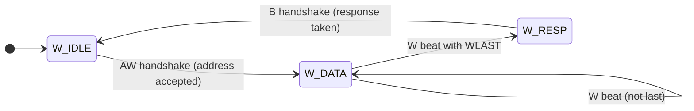
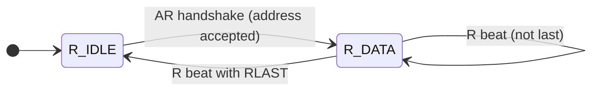
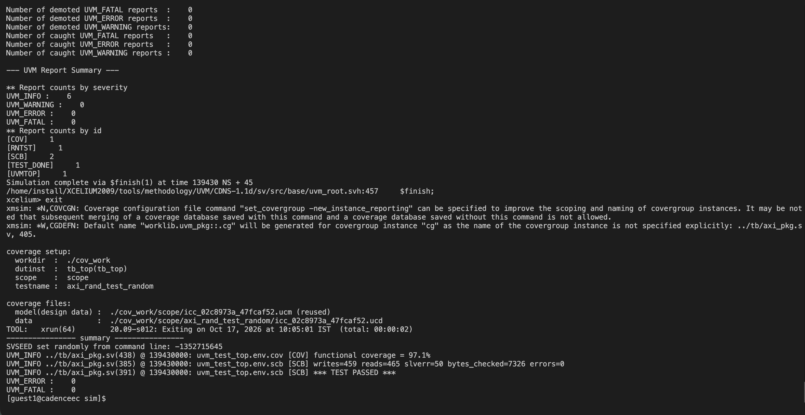
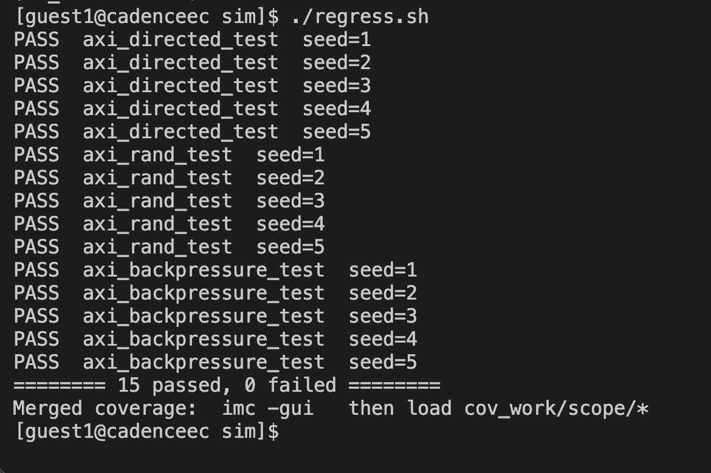
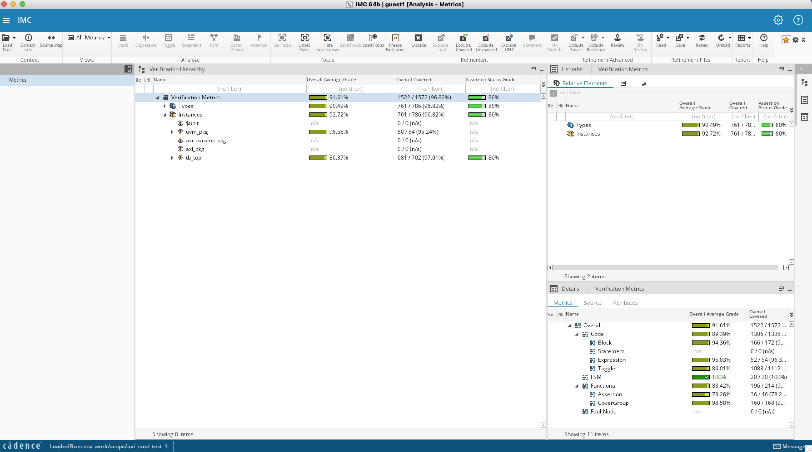

# AXI4 Memory Slave — My First RTL + UVM Verification Project


**Mayank Ratnakar** — M.Tech, Microelectronics and VLSI, IIT Bhilai

I am new to Verilog, SystemVerilog and verification. I built this project to
learn **how a real bus protocol (AXI4) works** and **how chips are verified in
industry (UVM)**. It started from a 5-line AND-gate testbench and grew step by
step into a memory with a full UVM testbench.

> **Honest note:** I built this while learning, with step-by-step guidance from
> an AI assistant (Claude). The practice files in [`learning/`](learning/) are
> the ones I typed, ran and debugged myself while learning the basics. The final
> RTL and UVM environment were written with the assistant's help; I ran them on
> the Cadence Xcelium server in my lab, read the logs, looked at the waveforms
> in SimVision, and I am still studying every part of the code.

**New to this? Start here:**
[AXI basics](docs/AXI_BASICS.md) →
[Glossary](docs/GLOSSARY.md) →
[Which file to read first](docs/READING_GUIDE.md) →
[My learning path](learning/)

The idea comes from the Iowa State thesis *"Design and Verification of AXI
Memory Interface"*, extended with more AXI features.

---

## AXI in 30 seconds (the courier analogy)

AXI is a set of rules for a **processor** (the master) to read and write a
**memory** (the slave). Think of it as a courier service with 5 separate lanes:

| Lane | Name           | Who sends | Courier analogy |
|------|----------------|-----------|-----------------|
| AW   | Write Address  | processor | "Deliver to house number 0x10" |
| W    | Write Data     | processor | the parcels (one per beat) |
| B    | Write Response | memory    | the delivery receipt |
| AR   | Read Address   | processor | "Bring me what is in house 0x10" |
| R    | Read Data      | memory    | the parcels coming back |

Every lane uses the same **VALID / READY handshake**: the sender raises VALID
("I have something"), the receiver raises READY ("I can take it"). Data moves
only on a clock edge where **both** are 1. A **burst** is several parcels for
one address label; the last parcel is marked with LAST.

More detail, in simple words: [`docs/AXI_BASICS.md`](docs/AXI_BASICS.md).

---

## What the design supports

* All five AXI4 channels, reads and writes at the same time
* Burst types FIXED, INCR and WRAP, 1 to 256 beats
* Narrow transfers (1, 2 or 4 bytes per beat) and unaligned addresses
* Write strobes (WSTRB): write only some bytes of a word
* Transaction IDs (the answer carries the same ID as the question)
* Error response SLVERR for requests the memory cannot do

### The two state machines inside the memory

Write side — one address, many data beats, then one response:



Read side — one address, then data beats until RLAST:



Compared with the reference thesis (INCR bursts only), this adds FIXED/WRAP
bursts, strobes, IDs, error responses, assertions and functional coverage.

---

## How the testbench checks the design

```
 test ─► env ─┬─ agent ─┬─ sequencer ─► driver ──► axi_if ──► DUT ◄── axi_sva (assertions)
              │         └─ monitor ◄────────────── axi_if
              ├─ scoreboard  (keeps its own copy of memory, compares every byte)
              └─ coverage    (records which kinds of bursts were tested)
```

| Part        | Job (in one line) | Analogy |
|-------------|-------------------|---------|
| sequence    | decides *what* to send (random or hand-picked bursts) | the exam paper |
| driver      | wiggles the AXI wires to send it | the student writing answers |
| monitor     | only watches the wires and writes down what happened | the CCTV camera |
| scoreboard  | compares memory's answers with its own expected copy | the examiner with the answer key |
| coverage    | counts which kinds of questions were asked | the syllabus checklist |
| assertions  | rules checked on every clock (e.g. VALID must not drop before READY) | the traffic police |

---

## Results (Cadence Xcelium 20.09, UVM 1.1d)

```
writes=466 reads=458 slverr=42 bytes_checked=8006 errors=0
functional coverage = 98.1%   (97-98% across seeds)
*** TEST PASSED ***
UVM_ERROR :    0
UVM_FATAL :    0
```

Terminal output at the end of a run on the lab server:



**Regression:** 3 tests × 5 random seeds = 15 runs, all passing
(`./regress.sh`). Each seed creates a different random mix of bursts:

| Test                    | What it does | Result |
|-------------------------|--------------|--------|
| `axi_directed_test`     | 24 hand-picked corner cases (WRAP, 256-beat burst, strobes, every error case) | 5 / 5 PASS |
| `axi_rand_test`         | ~900 random bursts, each write read back | 5 / 5 PASS |
| `axi_backpressure_test` | same, but the processor is slow to accept data | 5 / 5 PASS |



**Coverage in Cadence IMC** (`axi_rand_test`, seed 1). Coverage answers the
question "which parts of the design did the tests actually exercise?":

| Coverage type | Result | What it means (simply) |
|---------------|--------|------------------------|
| FSM           | **100%** (20/20) | every state and every state change of the read and write state machines happened |
| Expression    | 95.8% (52/54)    | almost every condition (`a && b`) was tried both true and false |
| Block         | 94.4% (166/172)  | almost every line of RTL ran at least once |
| Toggle        | 84.0%            | most wires went 0→1 and 1→0 (some upper address/ID bits rarely change) |
| Covergroup    | **98.6%** (160/168) | almost every kind of burst (type × size × length × direction) was tested |
| Assertions + covers | 78.3% (36/46) | all assertions passed; a few cover points (rare scenarios) were not hit in this one seed |
| **Overall**   | **91.6%** | |



**Waveform in SimVision** — a 4-beat write (AW → 4 W beats with WLAST → B),
a 4-beat read (AR → 4 R beats with RLAST), then a WRAP write where the
testbench pauses in the middle and makes the memory wait before taking the
response:


Whole run (145 µs). The long block near the start is a 256-beat burst:


**Does the testbench really catch bugs?** I broke the design on purpose in 5
different ways and re-ran the test. Every bug was caught:

| Bug I put in on purpose            | What caught it |
|------------------------------------|----------------|
| WRAP burst does not wrap around    | scoreboard (wrong data) |
| Write strobes ignored              | scoreboard (wrong data) |
| RLAST missing                      | assertion `a_rlast_position` |
| Response ID always 0               | assertion `a_bid_match` |
| Error response never sent          | scoreboard |

---

## Folder layout

```
learning/   my step-by-step practice files (AND gate → handshake → single write/read → burst)
rtl/        axi_mem.sv            the memory design (synthesizable)
tb/         tb_smoke.sv           simple testbench without UVM
            axi_params_pkg.sv     bus sizes + expected-address math
            axi_if.sv             the bundle of AXI wires
            axi_pkg.sv            UVM classes: driver, monitor, scoreboard, coverage, tests
            axi_sva.sv            protocol assertions
            tb_top.sv             top module that connects everything
sim/        run scripts (Cadence Xcelium, and Verilator for the simple test)
docs/       AXI basics, glossary, reading guide, screenshots
```

## How to run

**No Cadence? Use the free simulator Verilator** (runs the simple test + assertions):

```
sudo apt install verilator        # Ubuntu, needs version 5 or newer
cd sim
./run_smoke_verilator.sh          # prints TEST PASSED
```

**With Cadence Xcelium** (full UVM testbench):

```
cd sim
./run_smoke.sh                         # simple test, prints TEST PASSED
./run_uvm.sh                           # main UVM test
./run_uvm.sh axi_directed_test         # only the hand-picked corner cases
./run_uvm.sh axi_backpressure_test     # slow processor, lots of waiting
./run_uvm.sh axi_rand_test 1 gui       # open waveforms in SimVision
./regress.sh                           # 3 tests x 5 seeds
```

A run passes when the log shows `*** TEST PASSED ***` and `UVM_ERROR :    0`.

---

## What I learned

* VALID/READY handshake and why VALID must never wait for READY (deadlock)
* Why one burst has many data beats but only one response
* How to read a waveform in SimVision and find a handshake
* Why a testbench must be tested too (one early version said PASS while
  checking almost nothing; now the scoreboard fails if it compares too little)
* How the UVM pieces (driver, monitor, scoreboard) split the work

## What I am still learning / next steps

* Reading and explaining every line of the UVM code on my own
* Writing my own new sequences and assertions without help
* Multiple outstanding transactions and out-of-order IDs
* Closing the remaining coverage holes (toggle and cover points) with new tests
* Formal verification of the assertions (Cadence Jasper)

---

License: MIT
