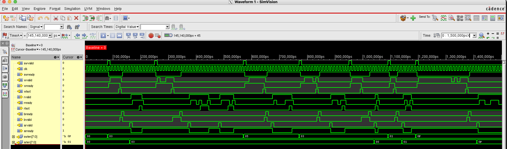
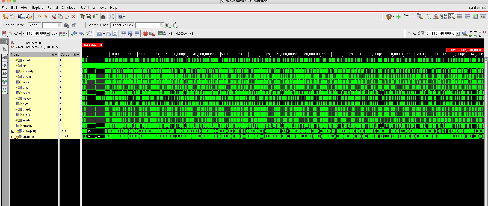

# AXI4 Memory Slave — RTL Design and UVM Verification


**Author:** Mayank Ratnakar — M.Tech, Microelectronics and VLSI, IIT Bhilai

A synthesizable AXI4 memory slave in SystemVerilog plus a full verification
environment: a UVM testbench with constrained-random stimulus, a scoreboard
with a reference model, functional coverage, and an SVA protocol checker.

Built on the idea of the Iowa State thesis *"Design and Verification of AXI
Memory Interface"*. Compared with that work, this version adds:

| Feature                       | Reference thesis       | This project |
|-------------------------------|------------------------|--------------|
| Burst types                   | INCR only              | FIXED, INCR, WRAP |
| Burst length                  | up to 16               | 1–256 beats |
| Narrow / unaligned transfers  | no                     | yes |
| Write strobes (WSTRB)         | no                     | per-byte |
| Transaction IDs (BID/RID)     | no                     | yes |
| Error responses               | no                     | SLVERR for unsupported requests |
| Read and write at same time   | —                      | independent paths |
| Protocol assertions (SVA)     | no                     | 15 assertions + 8 cover properties |
| Functional coverage           | basic                  | covergroup with crosses |
| Back-pressure testing         | no                     | random READY / VALID gaps |
| Bug-injection check of the TB | no                     | yes (see below) |

## Folder layout

```
rtl/axi_mem.sv          DUT: the AXI4 memory slave (synthesizable)
tb/tb_smoke.sv          quick self-checking testbench without UVM
tb/axi_params_pkg.sv    bus sizes + reference AXI address math
tb/axi_if.sv            interface (wires + monitor clocking block)
tb/axi_pkg.sv           UVM: transaction, driver, monitor, agent,
                        scoreboard, coverage, env, sequences, tests
tb/axi_sva.sv           SVA protocol checker, attached with 'bind'
tb/tb_top.sv            UVM top: clock, reset, DUT, run_test()
docs/                   waveform screenshots
sim/files.f             compile list for xrun
sim/run_smoke.sh        run the non-UVM test
sim/run_uvm.sh          run one UVM test
sim/regress.sh          all tests x several seeds, pass/fail table
```

## How to run (lab server, Cadence Xcelium)

```
csh
source /home/install/Cadence_cshrc.txt
setenv PATH /home/install/XCELIUM2009/tools.lnx86/bin:${PATH}
cd axi4_mem_project/sim

./run_smoke.sh                         # quick test, prints TEST PASSED
./run_uvm.sh                           # main UVM test (axi_rand_test)
./run_uvm.sh axi_directed_test         # only the corner cases
./run_uvm.sh axi_backpressure_test     # slow master, lots of stalls
./run_uvm.sh axi_rand_test 1234 gui    # fixed seed + SimVision waveforms
./regress.sh                           # 3 tests x 5 seeds
imc -gui &                             # coverage viewer: load cov_work/scope/<test>
```

A run passes when the log shows `*** TEST PASSED ***`, `UVM_ERROR :    0`
and no assertion failures.

## The DUT in one picture

```
           AW ──► [ write FSM: IDLE → DATA → RESP ] ──► B
            W ──►        │ byte writes (WSTRB)
                         ▼
                    mem[0 .. 2^ADDR_W-1]   (bytes)
                         ▲
           AR ──► [ read FSM:  IDLE → DATA ] ──► R
```

* Parameters: `DATA_W` (default 32), `ADDR_W` (8 → 256-byte memory), `ID_W` (4).
* One outstanding burst per direction; reads and writes run in parallel.
* SLVERR when: burst type is reserved (2'b11), AxSIZE is wider than the bus,
  WRAP length is not 2/4/8/16 beats, or WRAP start is not size-aligned.
  A write with SLVERR changes nothing; a read with SLVERR returns zeros.
* Lint clean (Verilator `-Wall`); synthesizes with Yosys with no latches.

## The testbench in one picture

```
 test ─► env ─┬─ agent ─┬─ sequencer ─► driver ──► axi_if ──► DUT ◄── axi_sva (bind)
              │         └─ monitor ◄────────────── axi_if
              ├─ scoreboard  (reference memory, checks data/ID/resp/RLAST/beat count)
              └─ coverage    (burst x size x direction, burst x length, responses)
```

* **Driver** drives on the falling clock edge, so the DUT never sees a
  changing signal on its rising edge (no races in any simulator).
  Knobs `bready_pct`, `rready_pct`, `wgap_pct` control back-pressure.
* **Monitor** only watches the wires (clocking block, `#1step` sampling)
  and rebuilds whole bursts.
* **Scoreboard** keeps a byte array of what memory should hold and checks
  every byte the DUT returns, plus BRESP/RRESP, BID/RID, RLAST position and
  the number of beats.
* **Reference model** computes burst addresses beat by beat straight from
  the spec, independently of the RTL, so the same mistake cannot hide in both.

### Tests

| Test                    | What it does |
|-------------------------|--------------|
| `axi_directed_test`     | 24 hand-picked corner cases: WRAP from mid-window, 16-beat WRAP, 256-beat byte burst, narrow + unaligned, FIXED, partial strobes, every SLVERR case |
| `axi_rand_test`         | directed + 300 random write/read-back pairs + 300 random mixed transactions (~5 % illegal) |
| `axi_backpressure_test` | same as rand, but READY only 20 % of the time and frequent W gaps |

## Results

**Cadence Xcelium 20.09, UVM 1.1d** — `axi_rand_test`, random seed 1267671211:

```
writes=466 reads=458 slverr=42 bytes_checked=8006 errors=0
functional coverage = 98.1%
*** TEST PASSED ***
UVM_ERROR :    0
UVM_FATAL :    0
```

Waveform of the first directed bursts in SimVision (4-beat INCR write + read,
then a WRAP write with a W-channel gap and B-channel back-pressure):



Whole 145 µs run (the long block near the start is the 256-beat burst):



Also checked with Verilator 5 + UVM before moving to Xcelium. Every run:
`UVM_ERROR : 0`, no assertion failures.

| Test                    | Bursts (wr + rd) | SLVERR cases | Bytes compared | Functional coverage |
|-------------------------|------------------|--------------|----------------|---------------------|
| `axi_directed_test`     | 12 + 12          | 6            | ~405           | 87.7 %              |
| `axi_rand_test`         | ~470 + ~450      | ~50          | ~2,700-3,100   | 97-98 %             |
| `axi_backpressure_test` | ~470 + ~450      | ~50          | ~2,700-3,100   | 97-98 %             |

Smoke test (non-UVM): 407 writes + 407 reads per run, ~15,000 checks, 0 errors.

**Does the testbench really catch bugs?** Each bug below was planted into the
RTL on purpose and the UVM test was run again. All five were caught:

| Planted bug                              | Caught by |
|------------------------------------------|-----------|
| WRAP burst does not wrap                 | scoreboard: 51 data mismatches |
| WSTRB ignored (all bytes written)        | scoreboard: 1,160 data mismatches |
| RLAST missing on 4-beat reads            | SVA `a_rlast_position` |
| BID not returned (always 0)              | SVA `a_bid_match` |
| SLVERR never returned                    | scoreboard (BRESP + corrupted data) |

Found on the way: one simulator silently ignored the `data.size() == len+1`
constraint, so writes went out with WSTRB = 0 and the test still "passed".
Fix: arrays are now built in `post_randomize()`, and the scoreboard fails any
test that compares too few bytes. A hung DUT now ends with a UVM timeout.

## Possible next steps

* Multiple outstanding transactions and out-of-order IDs.
* AXI4 4 KB boundary check, exclusive access (AxLOCK).
* A second agent in passive mode for system-level reuse.
* Formal proof of the SVA properties (Cadence Jasper).
